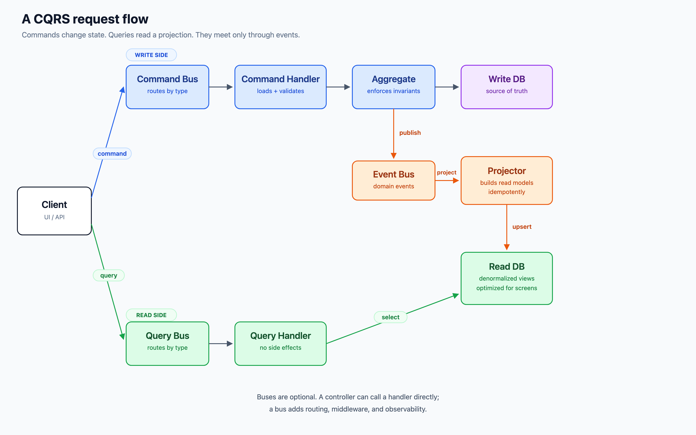
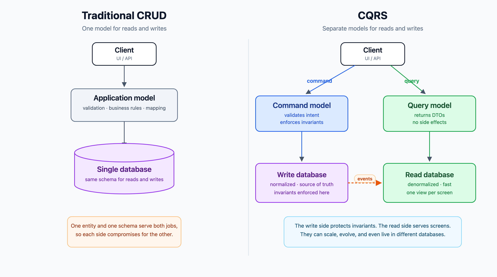
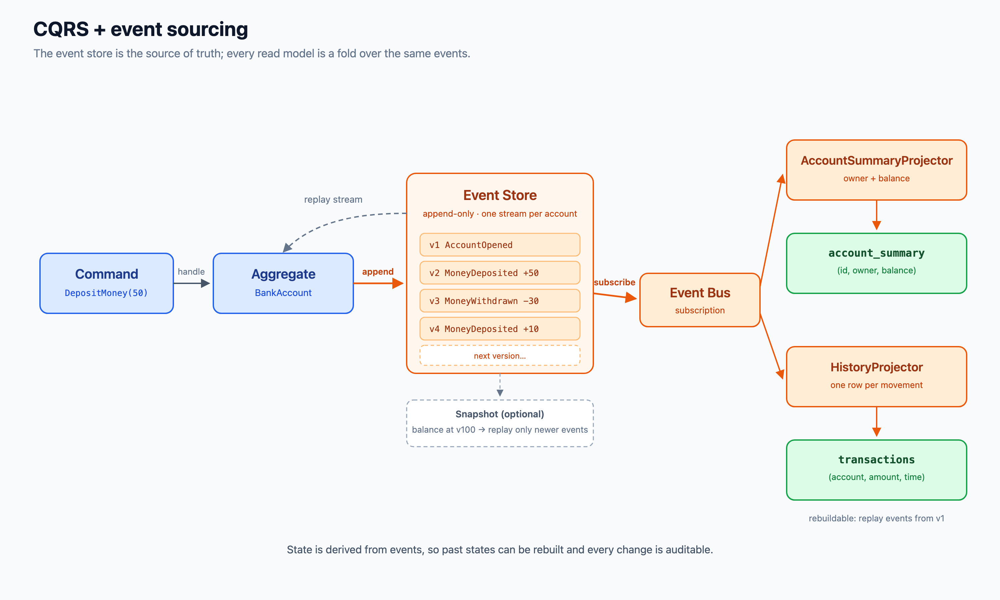
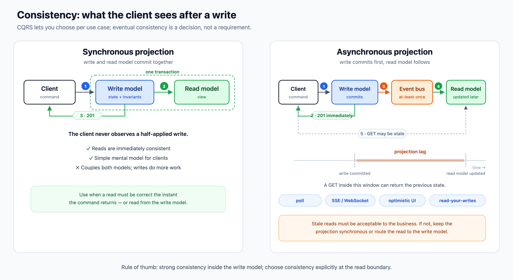
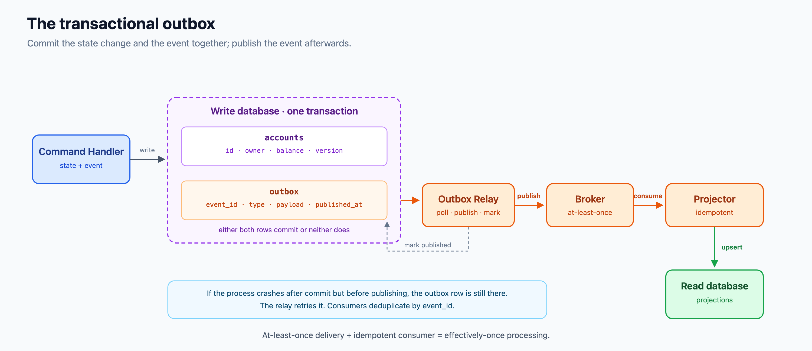

**Table of Contents**

- [What is CQRS?](#what-is-cqrs)
- [CQS vs. CQRS](#cqs-vs-cqrs)
- [The problem: one model, two jobs](#the-problem-one-model-two-jobs)
- [Core concepts](#core-concepts)
- [The two rules](#the-two-rules)
- [Request flow](#request-flow)
- [CRUD vs. CQRS](#crud-vs-cqrs)
- [How far should you go?](#how-far-should-you-go)
- [CQRS is not event sourcing](#cqrs-is-not-event-sourcing)
- [Consistency and projections](#consistency-and-projections)
- [Implementing CQRS in TypeScript](#implementing-cqrs-in-typescript)
- [Persistence: same database or separate?](#persistence-same-database-or-separate)
- [The dual-write problem and the outbox pattern](#the-dual-write-problem-and-the-outbox-pattern)
- [Validation, authorization, and cross-cutting concerns](#validation-authorization-and-cross-cutting-concerns)
- [Testing CQRS](#testing-cqrs)
- [Operating CQRS in production](#operating-cqrs-in-production)
- [Scaling reads and writes](#scaling-reads-and-writes)
- [Modular monolith vs. microservices](#modular-monolith-vs-microservices)
- [CQRS beyond the backend](#cqrs-beyond-the-backend)
- [When to use CQRS](#when-to-use-cqrs)
- [When not to use CQRS](#when-not-to-use-cqrs)
- [Benefits](#benefits)
- [Costs and pitfalls](#costs-and-pitfalls)
- [Common misconceptions](#common-misconceptions)
- [Decision checklist](#decision-checklist)
- [Ecosystem](#ecosystem)
- [Glossary](#glossary)
- [Key takeaways](#key-takeaways)
- [Further reading](#further-reading)

---

# What is CQRS?

**CQRS** stands for **Command Query Responsibility Segregation**. It is an architectural pattern that splits the application model into two sides:

- **Commands** change state. They express an intent such as "open an account", "deposit money", or "cancel an order". The command side protects business invariants and owns the truth.
- **Queries** read state. They return data shaped for a specific consumer, such as a screen, report, search result, or API response. Queries do not change business state.

The key word is **segregation**, not "database". At its smallest, CQRS means separate models in code. At its largest, it means separate services, separate databases, separate teams, and a stream of events connecting the write side to one or more read sides.

CQRS is usually attributed to **Greg Young**, who popularized it around 2010 in the domain-driven design community. It builds on **Command-Query Separation (CQS)**, a much older object-design principle from Bertrand Meyer.

> CQRS is a trade-off, not a default architecture. You gain simpler models, independent scaling, and read-optimized data. You pay with duplication, eventual consistency, and more moving parts.

# CQS vs. CQRS

**CQS** (Command-Query Separation) is a principle about methods:

- A **query** returns a value and has no side effects.
- A **command** performs an action and returns nothing.

```typescript
// Query: returns data, changes nothing
function getBalance(accountId: string): number {
  return balances.get(accountId) ?? 0;
}

// Command: changes state, returns nothing
function deposit(accountId: string, amount: number): void {
  balances.set(accountId, getBalance(accountId) + amount);
}
```

**CQRS** applies the same idea at the architecture level: separate the write model from the read model, and often separate the code paths, handlers, and storage that serve them.

| | CQS | CQRS |
|---|---|---|
| Level | Method or class design | Application or service architecture |
| Separates | Methods that read from methods that write | Models, handlers, and often data stores |
| Scope | An object | A bounded context, service, or whole application |
| Typical use | General OO design | Complex domains, read/write asymmetry, event-driven systems |

CQS is a principle. CQRS is a pattern that applies the principle to an entire application model. You can follow CQS without doing CQRS, and you can do CQRS without following CQS perfectly in every class.

# The problem: one model, two jobs

A traditional CRUD application uses one entity model and one database schema for both reads and writes. That works well for simple domains, but it creates tension as the application grows:

- **Writes care about invariants.** They need transactions, validation, concurrency control, and a model that protects the rules of the business.
- **Reads care about shape and speed.** They need joins, projections, pagination, search, caching, and data shaped for a particular screen.
- **The two needs pull the model in different directions.** Entities become bloated with read concerns, or they become anemic because all logic moved into services.
- **Read queries leak into the write model.** Lazy loading, ORM navigation properties, and "just one more field" turn the write model into a reporting model.
- **One schema cannot be optimal for both.** A normalized schema is good for writes and bad for dashboards. A denormalized schema is the opposite.
- **Scaling is coupled.** A flood of reads forces you to scale the same application and database that handle writes.
- **The UI becomes CRUD-shaped.** Generic "update" endpoints hide the real intent and make it hard to enforce business rules.

CQRS responds by giving each side its own model and, when needed, its own storage. The write side stays small and strict. The read side becomes free to denormalize aggressively for the use case at hand.

# Core concepts

| Concept | What it does | Notes |
|---|---|---|
| **Command** | A request to change state, named after the business intent | Examples: `OpenAccount`, `DepositMoney`, `CancelOrder`. It is data, not behavior. |
| **Command handler** | Loads the write model, invokes behavior, persists the result | One handler per command is the usual convention. |
| **Command bus** | Routes a command to its handler | Optional. A direct function call or controller can dispatch instead. |
| **Aggregate / write model** | The consistency boundary that enforces invariants | A command should usually modify one aggregate in one transaction. |
| **Write store** | The source of truth for the write side | Can be relational tables, a document store, or an event store. |
| **Domain event** | A fact that something happened in the domain | Examples: `MoneyDeposited`, `OrderCancelled`. Named in the past tense. |
| **Event bus** | Delivers events to interested consumers | Optional in-process; a broker when crossing process boundaries. |
| **Projection / read model** | A denormalized view built for a query | One read model per screen or use case is common. |
| **Projector** | Consumes events and updates a read model | Must be idempotent because delivery is usually at-least-once. |
| **Query** | A request for data with no business side effects | Examples: `GetAccountSummary`, `ListOpenOrders`. |
| **Query handler** | Reads the read model and returns a DTO | It can be a thin SQL query; it does not need a domain model. |
| **Query bus** | Routes a query to its handler | Optional, same as the command bus. |
| **Read store** | A database optimized for queries | Can be a separate database, a read replica, a search index, or a cache. |
| **Event store** | An append-only log of events used as the source of truth | Optional. Required for event sourcing, not required for CQRS. |
| **Snapshot** | A saved aggregate state used to avoid replaying a long event stream | An optimization for event-sourced systems. |
| **Process manager / saga** | Coordinates a multi-step workflow across aggregates or services | Used when one command triggers work in several places. |
| **Outbox** | Stores events in the same transaction as the state change before publishing them | Solves the dual-write problem. |
| **Integration event** | An event published across bounded contexts or services | A stable contract, separate from internal domain events. |

**Domain events vs. integration events.** A domain event is an internal fact, expressed in the language of one bounded context. An integration event is a message published to other services. They may carry the same information, but they have different contracts and different reasons to change. Do not leak internal domain events directly to every consumer and call that an integration contract.

**CQRS and DDD.** CQRS is often used with domain-driven design because aggregates give the write model a clear consistency boundary, and bounded contexts define where each model lives. You do not need full DDD to use CQRS, but the write side still needs explicit invariants; otherwise commands become CRUD in disguise.

# The two rules

1. **A command changes state and does not return read data.** It may return an identifier, a version, or an acknowledgement. If the caller needs data, it should issue a query.
2. **A query returns data and never changes business state.** Reading must be safe to repeat, cache, and parallelize.

These rules are guidelines with practical exceptions:

- Returning `{ id }` or `{ version }` from a command is common. It helps the client follow up with a query or implement read-your-writes. Returning a full read model from the write side re-couples the two models.
- Infrastructure side effects in a query, such as metrics or cache population, are usually acceptable. Mutating business state is not.
- Do not hide writes in a query. A query that updates `lastViewedAt` is a command in disguise. Make it an explicit command if the business cares about it.
- Do not let a query lazily load an ORM entity that writes back to the database. Read DTOs directly, or use a read-only transaction.

The deeper rule is about **responsibility**: each side has one job, and the code should make that job obvious.

# Request flow



*A command travels through the write side; a query travels through the read side. Events connect the two.*

A typical flow:

1. The client sends a command, for example `POST /accounts/42/deposits`.
2. The API validates the request shape and authorization, then dispatches the command.
3. The command handler loads the aggregate, calls a behavior method, and saves the result.
4. The write store commits the new state and records the resulting events.
5. A projector consumes the events and updates one or more read models.
6. Later, the client sends a query, for example `GET /accounts/42`.
7. The query handler reads the read model and returns a DTO.
8. The client renders the DTO.

Not every arrow is a network hop. In a modular monolith, all of this can happen in one process. The pattern is about separation of responsibility, not about how many services you deploy.

# CRUD vs. CQRS



*CRUD shares one model and one schema. CQRS gives each side a model optimized for its job.*

| Aspect | Traditional CRUD | CQRS |
|---|---|---|
| Model | One entity model for reads and writes | Separate write model and read model |
| Write API | Generic create/update/delete | Intent-revealing commands |
| Read API | Entity-shaped responses | DTOs shaped for a screen or use case |
| Database | Usually one schema | Same DB, separate tables, or separate DBs |
| Consistency | Immediate | Immediate or eventual, depending on the design |
| Scaling | Scale the whole application | Scale reads and writes independently |
| Complexity | Low | Higher: more code, more infrastructure, more concepts |
| Best fit | Simple domains, admin tools, prototypes | Complex domains, high read load, multiple read shapes |

A concrete example shows why intent matters. In CRUD, cancelling an order might be:

```http
PATCH /orders/42
Content-Type: application/json

{ "status": "cancelled" }
```

With commands, it becomes:

```http
POST /orders/42/cancellation
Content-Type: application/json

{ "reason": "customer requested" }
```

The second version can enforce rules that the first cannot express cleanly: only pending orders can be cancelled, a refund may be required, the customer must be notified, and the cancellation must be recorded. The endpoint describes **what happened**, not just which column changed.

A rough HTTP mapping:

| Intent | CRUD-style | CQRS-style |
|---|---|---|
| Create an account | `POST /accounts` | `POST /accounts` → `OpenAccount` |
| Add money | `PATCH /accounts/:id` | `POST /accounts/:id/deposits` → `DepositMoney` |
| Cancel an order | `PATCH /orders/:id` | `POST /orders/:id/cancellation` → `CancelOrder` |
| Read a summary | `GET /accounts/:id` | `GET /accounts/:id` → `GetAccountSummary` |

CQRS is not tied to HTTP verbs. The same split applies to GraphQL, gRPC, message queues, and in-process calls. GraphQL maps naturally to the query side, but a GraphQL mutation is still a command and should be handled as one.

# How far should you go?

CQRS is a spectrum. Teams often say "we do CQRS" while meaning very different levels of separation.

| Level | What is separate | Consistency | Cost | Good starting point when… |
|---|---|---|---|---|
| **1. Separate models, one database** | Command handlers and query handlers, but both use the same tables and transaction | Strong | Low | Reads and writes need different code, but not different storage |
| **2. Separate read tables or views** | Read models are dedicated tables/views, updated synchronously or asynchronously | Strong or eventual | Medium | Screens need denormalized shapes and reports are slowing the write model |
| **3. Separate databases** | Write DB and read DB(s), connected by events or CDC | Eventual | High | Reads need independent scaling or a different database technology |
| **4. Separate services and teams** | Write service and read service(s), with messaging between them | Eventual | Highest | Organizational boundaries and independent deployment justify it |

Start at the lowest level that solves the actual problem. A separate read table in the same database is often enough. Splitting databases and services introduces network partitions, message brokers, projection lag, replay procedures, and a lot of operational work.

A useful rule: **do not add a distributed system until a concrete force demands it.** "CQRS is best practice" is not a concrete force.

# CQRS is not event sourcing



*Event sourcing stores facts; CQRS builds read models from those facts. They complement each other, but neither requires the other.*

These are two different patterns:

- **CQRS** separates the write model from the read model.
- **Event sourcing** stores the sequence of events as the source of truth and derives current state by replaying them.

They are often used together because event sourcing produces a natural stream of events for projections. But they are independent:

| | State-stored CQRS | Event-sourced CQRS |
|---|---|---|
| Source of truth | Current rows in the write database | The event log |
| How the write model loads | Read rows, mutate, save | Replay the stream (or a snapshot plus later events) |
| Audit trail | Needs an audit table, CDC, or separate history | Built in |
| Temporal queries | Difficult | Natural: replay to a point in time |
| Schema evolution | Migrate tables | Version and upcast events; old events are immutable |
| Complexity | Lower | Higher |
| Best fit | Most CQRS systems | Domains where history, audit, and replay are first-class |

**CQRS without event sourcing** is the common case. The write side stores current state in normal tables, and an outbox or change-data-capture mechanism publishes events for the read side.

**Event sourcing without CQRS** is possible: an event-sourced aggregate can serve both writes and reads. It is less common because read queries usually want projections, not a replay of the entire stream.

Event sourcing brings extra costs:

- **Event schema evolution.** Old events remain in the log for the life of the system. You need versioning and upcasters.
- **Snapshots.** Replaying thousands of events per command is too slow; snapshots keep it bounded.
- **Deletion and privacy.** You cannot simply delete a row. Techniques such as crypto-shredding (encrypting personal data per subject and destroying the key) are used to satisfy deletion requirements.
- **Projection rebuilds.** Read models must be rebuildable, and rebuilding takes time and resources.
- **Operational maturity.** Event stores, subscriptions, checkpoints, and replay runbooks are additional systems to operate.

If you only need an audit trail, an append-only audit table may be enough. Do not adopt event sourcing just because it sounds more "event-driven".

# Consistency and projections



*Synchronous projection keeps reads immediate. Asynchronous projection buys decoupling and scale at the cost of a lag window.*

Consistency in CQRS has two layers:

1. **Write-side consistency.** Within one aggregate and one transaction, invariants are enforced strongly. A withdrawal cannot take the balance below zero. Optimistic concurrency prevents two commands from overwriting each other.
2. **Read-side consistency.** A read model may be updated in the same transaction, shortly after, or much later. This is where eventual consistency appears.

CQRS does not require eventual consistency. It makes the consistency boundary explicit, and then lets you choose per read model.

| Projection style | How it works | Trade-off |
|---|---|---|
| **Synchronous, same transaction** | The write and read tables are updated in one transaction | Strong consistency, but writes do more work and the models are coupled at the database level |
| **Synchronous, in-process, after commit** | The handler updates the read model before returning, but outside the write transaction | Usually consistent, but a failure can leave the projection behind; retries are needed |
| **Asynchronous, in-process** | Events are queued; a background consumer updates the read model | Fast writes, but reads can lag |
| **Asynchronous, out-of-process** | A broker delivers events to a separate projector service | Independent scaling and deployment, plus the most operational complexity |
| **CDC / log tailing** | A connector reads the database log and updates the read model | No application-level dual write, but coupling to the database log format |

## Eventual consistency is not "eventually correct"

Eventual consistency means that, if no new updates arrive, all read models eventually reflect the latest write. It does not mean the data is wrong, and it does not mean the delay is acceptable for every use case.

Projection lag is usually milliseconds, but it can grow during:

- broker outages or backlogs,
- projector crashes and restarts,
- large replays or backfills,
- hot partitions,
- slow downstream databases,
- schema changes or bug fixes.

You need to decide, per read model, what happens when the projection is behind.

## Read-your-writes

A common problem: a user submits a command and is immediately sent to a page that reads a projection. The projection has not caught up, so the user does not see their own change.

Options:

- **Return a version from the command.** The client polls the read endpoint with the version or an `ETag` until the read model reaches it.
- **Route the user's next read to the write model.** Keep it short-lived and scoped to the user or aggregate. Do not make this the permanent read path.
- **Use an optimistic UI.** Show the change immediately as "pending", then reconcile when the projection arrives.
- **Push the update.** Use SSE or WebSocket to notify the client when the projection catches up.
- **Make the critical projection synchronous.** If a screen truly cannot tolerate lag, update that read model in the same transaction or read directly from the write model.
- **Use a "read after write" token.** The command returns a token that identifies the minimum version the client should see; read replicas or query handlers wait for that version.

Two related guarantees are worth naming. **Monotonic reads** means a client never moves backwards to an older version after seeing a newer one. **Consistent prefix** means a client sees events or versions in order, without gaps. Both matter when a user can hit different read replicas or projections during one session.

There is no universal answer. The right choice depends on the business cost of showing stale data.

## Making projections reliable

A production projector needs more than a `switch` statement:

- **Idempotency.** Delivery is usually at-least-once. Deduplicate by event ID, use upserts, or make updates naturally idempotent (for example, "set balance to X" rather than "add X"). Store the deduplication record in the same transaction as the read-model update when possible.
- **Ordering.** Events for one aggregate must be applied in order. Partition by aggregate or stream ID. Do not assume global ordering across all aggregates.
- **Checkpoints.** Store the last processed position per projection. On restart, resume from the checkpoint instead of replaying everything or skipping events.
- **Rebuildability.** Keep the projection code deterministic and replayable. Build a new read model from scratch, catch it up, then switch traffic to it (blue/green). Keep the old one until the new one is verified.
- **Schema evolution.** Events are immutable. Add new optional fields, version event types, and use upcasters to translate old events into the current shape. Never silently change the meaning of an existing event.
- **Failure handling.** Retry transient failures with backoff. Send poison messages to a dead-letter queue with enough context to investigate. Alert on projection lag, not just on crashes.
- **Poison-event isolation.** One bad event should not block an entire partition forever. Have a runbook for skipping, fixing, or replaying it.
- **Backfills.** When adding a new read model, you often need to replay historical events. Plan for the load this puts on the event store and the read database.

# Implementing CQRS in TypeScript

The following example implements a small bank account with CQRS and event sourcing. It is intentionally in-memory and synchronous so that the moving parts are visible. Each step notes what a production implementation would change.

The example uses:

- a **write model** (`BankAccount`) that enforces invariants,
- an **event store** that appends events with optimistic concurrency,
- a **projector** that builds an `AccountSummary` read model,
- **commands** and **queries** with separate handlers,
- a small **composition root** that dispatches messages.

## Step 1: Define the domain events

```typescript
// domain/events.ts
export type DomainEvent =
  | {
      type: "AccountOpened";
      accountId: string;
      owner: string;
      initialBalance: number;
    }
  | { type: "MoneyDeposited"; accountId: string; amount: number }
  | { type: "MoneyWithdrawn"; accountId: string; amount: number };

export type StoredEvent = {
  eventId: string;
  streamId: string;
  version: number;
  event: DomainEvent;
  occurredAt: string;
};
```

Events are named in the past tense because they describe facts that have already happened. `StoredEvent` is an envelope: it adds identity, stream position, and metadata without polluting the domain event itself.

## Step 2: Write the aggregate

```typescript
// domain/bank-account.ts
import type { DomainEvent } from "./events";

export class BankAccount {
  private constructor(
    private readonly id: string,
    private owner: string,
    private balance: number,
    private isOpen: boolean,
  ) {}

  static open(
    id: string,
    owner: string,
    initialBalance: number,
  ): DomainEvent[] {
    if (!owner.trim()) {
      throw new Error("Owner is required");
    }
    if (!Number.isFinite(initialBalance) || initialBalance < 0) {
      throw new Error("Initial balance cannot be negative");
    }

    return [
      { type: "AccountOpened", accountId: id, owner, initialBalance },
    ];
  }

  static rehydrate(id: string, events: DomainEvent[]): BankAccount {
    const account = new BankAccount(id, "", 0, false);
    for (const event of events) {
      account.apply(event);
    }
    return account;
  }

  deposit(amount: number): DomainEvent[] {
    this.assertOpen();
    if (!Number.isFinite(amount) || amount <= 0) {
      throw new Error("Deposit must be a positive number");
    }

    return [{ type: "MoneyDeposited", accountId: this.id, amount }];
  }

  withdraw(amount: number): DomainEvent[] {
    this.assertOpen();
    if (!Number.isFinite(amount) || amount <= 0) {
      throw new Error("Withdrawal must be a positive number");
    }
    if (amount > this.balance) {
      throw new Error("Insufficient funds");
    }

    return [{ type: "MoneyWithdrawn", accountId: this.id, amount }];
  }

  private assertOpen(): void {
    if (!this.isOpen) {
      throw new Error("Account is not open");
    }
  }

  private apply(event: DomainEvent): void {
    switch (event.type) {
      case "AccountOpened":
        this.owner = event.owner;
        this.balance = event.initialBalance;
        this.isOpen = true;
        break;
      case "MoneyDeposited":
        this.balance += event.amount;
        break;
      case "MoneyWithdrawn":
        this.balance -= event.amount;
        break;
    }
  }
}
```

This aggregate makes decisions without mutating itself. `deposit` and `withdraw` return the events that *would* result; `rehydrate` is the only path that changes state. That keeps the business rules easy to test.

An alternative style mutates the aggregate and collects events in an internal list:

```typescript
deposit(amount: number): void {
  if (amount <= 0) throw new Error("Deposit must be positive");
  this.balance += amount;
  this.record({ type: "MoneyDeposited", accountId: this.id, amount });
}
```

Both styles work. The important part is that the aggregate is the place where invariants live.

If you are **not** using event sourcing, the write model stores current state directly. The methods mutate the aggregate, and the repository saves it. You still publish events for the read side, usually through an outbox.

## Step 3: Define commands and handlers

```typescript
// application/commands.ts
export type Command =
  | {
      type: "OpenAccount";
      accountId: string;
      owner: string;
      initialBalance: number;
    }
  | { type: "DepositMoney"; accountId: string; amount: number }
  | { type: "WithdrawMoney"; accountId: string; amount: number };

export type OpenAccount = Extract<Command, { type: "OpenAccount" }>;
export type DepositMoney = Extract<Command, { type: "DepositMoney" }>;
export type WithdrawMoney = Extract<Command, { type: "WithdrawMoney" }>;
```

```typescript
// application/command-handlers.ts
import { BankAccount } from "../domain/bank-account";
import type { EventStore } from "./event-store";
import type { DepositMoney, OpenAccount, WithdrawMoney } from "./commands";

export class OpenAccountHandler {
  constructor(private readonly store: EventStore) {}

  async execute(command: OpenAccount): Promise<void> {
    const events = BankAccount.open(
      command.accountId,
      command.owner,
      command.initialBalance,
    );

    // A new stream must start at version 0.
    await this.store.append(command.accountId, 0, events);
  }
}

export class DepositMoneyHandler {
  constructor(private readonly store: EventStore) {}

  async execute(command: DepositMoney): Promise<void> {
    const stream = await this.store.load(command.accountId);
    const account = BankAccount.rehydrate(
      command.accountId,
      stream.events,
    );

    await this.store.append(
      command.accountId,
      stream.version,
      account.deposit(command.amount),
    );
  }
}

export class WithdrawMoneyHandler {
  constructor(private readonly store: EventStore) {}

  async execute(command: WithdrawMoney): Promise<void> {
    const stream = await this.store.load(command.accountId);
    const account = BankAccount.rehydrate(
      command.accountId,
      stream.events,
    );

    await this.store.append(
      command.accountId,
      stream.version,
      account.withdraw(command.amount),
    );
  }
}
```

Each handler does the same three things: load, decide, save. It does not return the new balance. If the caller needs the balance, it asks the query side.

The **expected version** passed to `append` is important. It implements optimistic concurrency: if another command changed the stream in the meantime, the append fails instead of silently overwriting it.

## Step 4: Implement the event store

```typescript
// application/event-store.ts
import type { DomainEvent, StoredEvent } from "../domain/events";

export type EventStream = {
  version: number;
  events: DomainEvent[];
};

export interface EventStore {
  load(streamId: string): Promise<EventStream>;
  append(
    streamId: string,
    expectedVersion: number,
    events: DomainEvent[],
  ): Promise<void>;
}

type Listener = (event: StoredEvent) => Promise<void>;

export class InMemoryEventStore implements EventStore {
  private readonly streams = new Map<string, StoredEvent[]>();
  private readonly listeners: Listener[] = [];

  async load(streamId: string): Promise<EventStream> {
    const stored = this.streams.get(streamId) ?? [];

    return {
      version: stored.length,
      events: stored.map((record) => record.event),
    };
  }

  async append(
    streamId: string,
    expectedVersion: number,
    events: DomainEvent[],
  ): Promise<void> {
    const stored = this.streams.get(streamId) ?? [];

    if (stored.length !== expectedVersion) {
      throw new Error(
        `Concurrency conflict on ${streamId}: expected v${expectedVersion}, found v${stored.length}`,
      );
    }

    const appended = events.map((event, index) => ({
      eventId: crypto.randomUUID(),
      streamId,
      version: expectedVersion + index + 1,
      event,
      occurredAt: new Date().toISOString(),
    }));

    this.streams.set(streamId, [...stored, ...appended]);

    // This example dispatches inline, so the projection is synchronous.
    // A production system would publish after commit through an outbox
    // or a durable subscription to the event log.
    for (const record of appended) {
      for (const listener of this.listeners) {
        await listener(record);
      }
    }
  }

  subscribe(listener: Listener): void {
    this.listeners.push(listener);
  }
}
```

In a real database, the append should be a single transaction with a unique constraint on `(stream_id, version)`. That constraint is what makes optimistic concurrency safe under parallel writers. The in-memory version is atomic because JavaScript runs the check and the write without an `await` in between; a real implementation needs a database guarantee.

The inline `listeners` loop is deliberately simple, but it has a production flaw: if a projector fails after the events are stored, the command fails even though the write succeeded. A real system publishes through an **outbox** or a subscription to the event store, and the projector retries independently. See [The dual-write problem](#the-dual-write-problem-and-the-outbox-pattern).

## Step 5: Build the read model and projector

```typescript
// read-model/account-summary.ts
import type { StoredEvent } from "../domain/events";

export type AccountSummary = {
  accountId: string;
  owner: string;
  balance: number;
  transactions: number;
};

export class AccountSummaryProjector {
  private readonly summaries = new Map<string, AccountSummary>();
  private readonly processed = new Set<string>();

  async handle(record: StoredEvent): Promise<void> {
    if (this.processed.has(record.eventId)) {
      return; // at-least-once delivery: ignore duplicates
    }

    const summary = this.summaries.get(record.streamId) ?? {
      accountId: record.streamId,
      owner: "",
      balance: 0,
      transactions: 0,
    };

    switch (record.event.type) {
      case "AccountOpened":
        summary.owner = record.event.owner;
        summary.balance = record.event.initialBalance;
        break;
      case "MoneyDeposited":
        summary.balance += record.event.amount;
        summary.transactions += 1;
        break;
      case "MoneyWithdrawn":
        summary.balance -= record.event.amount;
        summary.transactions += 1;
        break;
    }

    this.summaries.set(record.streamId, summary);
    this.processed.add(record.eventId);
  }

  get(accountId: string): AccountSummary | undefined {
    return this.summaries.get(accountId);
  }
}
```

The read model is not a domain entity. It is a **view** with exactly the fields the screen needs. It can be denormalized, duplicated, and rebuilt from events. In a database, `summary` would be a row in a table such as `account_summary_view`, and the processed event IDs would live in a deduplication table or be enforced by upsert semantics.

The `processed` set grows forever in this example. Production code needs retention, partitioning, or a database uniqueness constraint instead of an in-memory set.

## Step 6: Define queries and query handlers

```typescript
// application/queries.ts
export type Query = {
  type: "GetAccountSummary";
  accountId: string;
};

export type GetAccountSummary = Extract<
  Query,
  { type: "GetAccountSummary" }
>;
```

```typescript
// application/query-handlers.ts
import type {
  AccountSummary,
  AccountSummaryProjector,
} from "../read-model/account-summary";
import type { GetAccountSummary } from "./queries";

export class GetAccountSummaryHandler {
  constructor(private readonly summaries: AccountSummaryProjector) {}

  async execute(
    query: GetAccountSummary,
  ): Promise<AccountSummary | null> {
    return this.summaries.get(query.accountId) ?? null;
  }
}
```

Notice how small the query handler is. That is normal. Queries do not need aggregates, repositories, or domain rules. They need a fast path to the data.

## Step 7: Wire everything together

```typescript
// composition-root.ts
import type { Command } from "./application/commands";
import {
  DepositMoneyHandler,
  OpenAccountHandler,
  WithdrawMoneyHandler,
} from "./application/command-handlers";
import type { Query } from "./application/queries";
import { GetAccountSummaryHandler } from "./application/query-handlers";
import { InMemoryEventStore } from "./application/event-store";
import {
  AccountSummaryProjector,
  type AccountSummary,
} from "./read-model/account-summary";

const eventStore = new InMemoryEventStore();
const summaries = new AccountSummaryProjector();

// Synchronous projection: the command waits for the read model update.
eventStore.subscribe((event) => summaries.handle(event));

const handlers = {
  openAccount: new OpenAccountHandler(eventStore),
  depositMoney: new DepositMoneyHandler(eventStore),
  withdrawMoney: new WithdrawMoneyHandler(eventStore),
};

const getAccountSummary = new GetAccountSummaryHandler(summaries);

export async function execute(command: Command): Promise<void> {
  switch (command.type) {
    case "OpenAccount":
      return handlers.openAccount.execute(command);
    case "DepositMoney":
      return handlers.depositMoney.execute(command);
    case "WithdrawMoney":
      return handlers.withdrawMoney.execute(command);
  }
}

export async function query(
  message: Query,
): Promise<AccountSummary | null> {
  switch (message.type) {
    case "GetAccountSummary":
      return getAccountSummary.execute(message);
  }
}
```

This is a simple **dispatch table**, not a framework. It makes the routing explicit and shows that a command bus is not magic. A bus is just a map from message type to handler, plus optional middleware for validation, logging, transactions, and metrics.

### Suggested folder structure

```text
src/
  accounts/
    domain/
      bank-account.ts
      events.ts
    application/
      commands.ts
      command-handlers.ts
      queries.ts
      query-handlers.ts
      event-store.ts
    read-model/
      account-summary.ts
    http/
      accounts.ts
    composition-root.ts
  shared/
    messaging/
      command-bus.ts
      query-bus.ts
```

Organize by **feature or bounded context first**, not by technical layer first. Keeping the write model, read model, handlers, and endpoints for one feature together makes the boundary visible and prevents a giant `commands/` folder that every team has to touch.

## Step 8: Use the application

```typescript
await execute({
  type: "OpenAccount",
  accountId: "acc-1",
  owner: "Ada",
  initialBalance: 100,
});

await execute({
  type: "DepositMoney",
  accountId: "acc-1",
  amount: 50,
});

await execute({
  type: "WithdrawMoney",
  accountId: "acc-1",
  amount: 30,
});

console.log(
  await query({ type: "GetAccountSummary", accountId: "acc-1" }),
);
// { accountId: "acc-1", owner: "Ada", balance: 120, transactions: 2 }
```

The balance is derived from the events:

```
100 (opened) + 50 (deposit) - 30 (withdrawal) = 120
```

## Step 9: Expose HTTP endpoints

The following example uses [Hono](https://hono.dev/), but the same shape works with Express, Fastify, NestJS, or any other HTTP framework.

```typescript
// http/accounts.ts
import { Hono } from "hono";
import { execute, query } from "../composition-root";

const app = new Hono();

app.post("/accounts", async (c) => {
  const body = await c.req.json<{
    owner: string;
    initialBalance: number;
  }>();
  const accountId = crypto.randomUUID();

  await execute({
    type: "OpenAccount",
    accountId,
    owner: body.owner,
    initialBalance: body.initialBalance,
  });

  return c.json({ accountId }, 201);
});

app.post("/accounts/:accountId/deposits", async (c) => {
  const { amount } = await c.req.json<{ amount: number }>();

  await execute({
    type: "DepositMoney",
    accountId: c.req.param("accountId"),
    amount,
  });

  return c.body(null, 204);
});

app.post("/accounts/:accountId/withdrawals", async (c) => {
  const { amount } = await c.req.json<{ amount: number }>();

  await execute({
    type: "WithdrawMoney",
    accountId: c.req.param("accountId"),
    amount,
  });

  return c.body(null, 204);
});

app.get("/accounts/:accountId", async (c) => {
  const summary = await query({
    type: "GetAccountSummary",
    accountId: c.req.param("accountId"),
  });

  return summary
    ? c.json(summary)
    : c.json({ error: "Not found" }, 404);
});
```

Important details:

- **`201 Created`** is honest here because the write model has committed by the time the handler returns. If the command is queued and processed later, use **`202 Accepted`** and give the client a way to check status.
- **The query endpoint may be stale** if the projection is asynchronous. In this example the projection is synchronous, so a `GET` immediately after a `POST` sees the new state. Remove the synchronous subscription and the same `GET` may return the previous balance.
- **`POST` retries are dangerous.** A client or proxy may retry a request after a timeout. Use an idempotency key to avoid depositing twice.
- **Map domain errors to HTTP status codes.** Validation failures are `400`, missing resources are `404`, insufficient funds or state conflicts are `409` or `422`, and optimistic concurrency conflicts are `409`. Do not let expected business rejections become `500`s.
- **Do not return the aggregate.** The response should be a DTO, not an ORM entity or domain object.

## The same idea with NestJS

NestJS has a first-party CQRS module that provides command, query, and event buses.

```typescript
// deposit-money.command.ts
export class DepositMoneyCommand {
  constructor(
    public readonly accountId: string,
    public readonly amount: number,
  ) {}
}
```

```typescript
// deposit-money.handler.ts
import { CommandHandler, ICommandHandler } from "@nestjs/cqrs";

@CommandHandler(DepositMoneyCommand)
export class DepositMoneyHandler
  implements ICommandHandler<DepositMoneyCommand>
{
  constructor(private readonly accounts: AccountRepository) {}

  async execute(command: DepositMoneyCommand): Promise<void> {
    const account = await this.accounts.get(command.accountId);
    account.deposit(command.amount);
    await this.accounts.save(account);
  }
}
```

```typescript
// accounts.controller.ts
@Post(":accountId/deposits")
async deposit(
  @Param("accountId") accountId: string,
  @Body() body: DepositDto,
) {
  await this.commandBus.execute(
    new DepositMoneyCommand(accountId, body.amount),
  );

  return { status: "accepted" };
}
```

The module also provides `QueryBus`, `EventBus`, `@QueryHandler`, and `@EventsHandler`. It does **not** provide an event store, outbox, projection runner, or replay tooling. Those remain your responsibility or the responsibility of another library.

# Persistence: same database or separate?

The right persistence choice follows the level of CQRS you need.

| Option | Consistency | Operational cost | When it fits |
|---|---|---|---|
| Same tables, separate handlers | Strong | Low | First step; different code paths, same data |
| Same database, separate read tables or views | Strong or eventual | Low/medium | Different read shapes; reporting queries; materialized views |
| Separate read database | Eventual | Medium/high | Read scaling, different database technology, search |
| Separate write and read services | Eventual | High | Independent deployment, team boundaries, large scale |

A normalized write schema and a denormalized read schema can live in the same database:

```sql
-- Write side: normalized and transactional
CREATE TABLE accounts (
  id UUID PRIMARY KEY,
  owner TEXT NOT NULL,
  balance NUMERIC(12, 2) NOT NULL CHECK (balance >= 0),
  version INTEGER NOT NULL DEFAULT 0
);

-- Read side: shaped for one screen
CREATE TABLE account_summary_view (
  account_id UUID PRIMARY KEY,
  owner TEXT NOT NULL,
  balance NUMERIC(12, 2) NOT NULL,
  transaction_count INTEGER NOT NULL DEFAULT 0,
  updated_at TIMESTAMPTZ NOT NULL DEFAULT now()
);
```

With event sourcing, the write side becomes an append-only table:

```sql
CREATE TABLE event_store (
  stream_id UUID NOT NULL,
  stream_version INTEGER NOT NULL,
  event_id UUID NOT NULL UNIQUE,
  event_type TEXT NOT NULL,
  payload JSONB NOT NULL,
  occurred_at TIMESTAMPTZ NOT NULL DEFAULT now(),
  PRIMARY KEY (stream_id, stream_version)
);
```

The primary key on `(stream_id, stream_version)` enforces optimistic concurrency. Two commands that try to append version 5 will conflict; one succeeds and the other retries or fails.

A projection checkpoint table is also useful:

```sql
CREATE TABLE projection_checkpoints (
  projection_name TEXT PRIMARY KEY,
  last_event_id UUID,
  last_stream_version INTEGER,
  updated_at TIMESTAMPTZ NOT NULL DEFAULT now()
);
```

If the read model is in the same database, you can update it in the same transaction as the write. That gives strong consistency but couples the two schemas. If it is in a different database, you cannot use a normal transaction across both; you need events, an outbox, or CDC.

**Do not share a read database between services.** That turns the read model into a distributed monolith and makes schema changes everyone's problem. Each service should own its data, even if that means duplicating some information in a read model.

# The dual-write problem and the outbox pattern

A naive CQRS implementation does this:

1. Save the aggregate to the write database.
2. Publish an event to a message broker.

These are two separate systems. One can succeed while the other fails:

- The database commits, but the broker is down. The read model never updates.
- The broker publishes, but the database transaction rolls back. Consumers react to an event that never happened.

You cannot fix this with a normal database transaction across both systems. Distributed transactions (two-phase commit) are usually avoided because they are slow, brittle, and often unsupported by brokers and databases.

The **transactional outbox** pattern solves it:

1. In the **same database transaction**, write the aggregate state and insert an outbox record.
2. A separate relay reads unpublished outbox rows and publishes them to the broker.
3. The relay marks rows as published.
4. Consumers process events idempotently.



*The state change and the event commit atomically; publication happens later and can be retried.*

```sql
CREATE TABLE outbox (
  id BIGSERIAL PRIMARY KEY,
  event_id UUID NOT NULL UNIQUE,
  aggregate_id UUID NOT NULL,
  event_type TEXT NOT NULL,
  payload JSONB NOT NULL,
  created_at TIMESTAMPTZ NOT NULL DEFAULT now(),
  published_at TIMESTAMPTZ
);
```

A relay query might look like this:

```sql
SELECT id, event_id, event_type, payload
FROM outbox
WHERE published_at IS NULL
ORDER BY id
FOR UPDATE SKIP LOCKED
LIMIT 100;
```

`FOR UPDATE SKIP LOCKED` lets multiple relay instances work without stepping on each other. After publishing, mark the rows as published.

Key properties:

- **At-least-once delivery.** The relay can crash after publishing but before marking the row. The event will be sent again. Consumers must be idempotent.
- **Ordering.** Publish in outbox order, and preserve per-aggregate ordering at the consumer. Global ordering is usually unnecessary and expensive.
- **True end-to-end exactly-once delivery is not generally achievable.** A broker may offer exactly-once semantics within its own boundary, but once you combine a database, a broker, and a projector, you need **effectively-once processing**: at-least-once delivery plus deduplication or idempotent writes.
- **Outbox cleanup.** Delete or archive published rows on a schedule. The outbox is a queue, not a permanent event log.
- **CDC alternative.** Instead of an application-level outbox, a connector such as Debezium can tail the database log and publish changes. This removes the application dual write but couples you to the database's log format and requires careful schema handling.
- **Event-store alternative.** If the event store is the source of truth, a subscription to its log can replace the outbox. You still need checkpoints, retries, and idempotent consumers.

A subtle point: publishing an event and updating a projection are also two writes. The projector needs the same discipline. Store the checkpoint and the read-model update in one transaction, or make the update idempotent and the checkpoint monotonic.

# Validation, authorization, and cross-cutting concerns

CQRS does not remove the need for the usual application concerns. It changes where they live.

## Validation

There are three layers:

1. **Syntactic validation at the boundary.** Is the payload well-formed? Is `amount` a positive number? Is `accountId` a UUID? Use a schema validator such as Zod.
2. **Business validation in the domain.** Can this account withdraw this amount? Is the order still cancellable? These rules belong in the aggregate or domain service, not in the controller.
3. **Consistency validation at commit.** Has the aggregate version changed? Is the unique constraint satisfied? The database enforces this.

```typescript
import { z } from "zod";

const depositSchema = z.object({
  accountId: z.string().uuid(),
  amount: z.number().positive().finite(),
});

const input = depositSchema.parse(await request.json());
```

Do not rely on the read model for authorization or invariants. The read model may be stale by design.

## Authorization

Authorize commands and queries separately:

- **Commands** need permission to perform the action. Check the tenant, the user's role, and the specific aggregate.
- **Queries** need permission to see the data. Filter by tenant and apply row-level security. Do not assume a read model is safe because it is "just a view".
- **Events** may contain sensitive data. Treat event payloads as production data: encrypt, restrict access, and define retention.

A command handler is a good place for the final authorization check because it has the loaded aggregate and the current state. A controller check alone can be bypassed by another entry point.

## Idempotency

Clients retry. Networks duplicate. Brokers deliver at least once. Commands need idempotency when duplicates would cause harm.

Common approaches:

- **Idempotency key.** The client sends a unique key (for example, `Idempotency-Key: ...`). Store the key and the command result. On retry, return the stored result instead of executing again.
- **Natural idempotency.** Make the operation naturally idempotent, such as `SetShippingAddress` instead of `AppendShippingAddress`.
- **Deduplication table.** Store processed command IDs with a unique constraint; insert in the same transaction as the write.
- **Optimistic concurrency.** Version checks prevent some duplicates, but not all. A retried command that was already applied may fail with a conflict; map that to a sensible response.

## Cross-cutting pipeline

A command bus often supports middleware or behaviors for:

- logging and tracing,
- validation,
- authorization,
- transaction management,
- idempotency,
- metrics,
- retries (carefully; not all commands are safe to retry),
- correlation ID propagation.

Keep the pipeline explicit. Too much hidden middleware makes a command handler hard to reason about.

## Correlation and tracing

Propagate a correlation ID from the HTTP request to the command, the events, and the projection updates. When a user reports "my deposit is missing from the dashboard", you need to trace one ID across the write database, the outbox, the broker, and the projector.

# Testing CQRS

CQRS is very testable if you keep the layers separate.

## Aggregate tests

The aggregate is pure decision logic. Test it with a **given/when/then** style:

- **Given** a sequence of events,
- **when** a command method is called,
- **then** it returns the expected events or throws the expected error.

```typescript
import { describe, expect, it } from "vitest";
import { BankAccount } from "./bank-account";

const opened = {
  type: "AccountOpened" as const,
  accountId: "acc-1",
  owner: "Ada",
  initialBalance: 100,
};

describe("BankAccount", () => {
  it("rejects a withdrawal above the balance", () => {
    const account = BankAccount.rehydrate("acc-1", [opened]);

    expect(() => account.withdraw(150)).toThrow("Insufficient funds");
  });

  it("emits MoneyWithdrawn when funds are sufficient", () => {
    const account = BankAccount.rehydrate("acc-1", [opened]);

    expect(account.withdraw(40)).toEqual([
      { type: "MoneyWithdrawn", accountId: "acc-1", amount: 40 },
    ]);
  });
});
```

Because the aggregate does not touch a database, these tests are fast and deterministic. Add cases for every invariant and every event type.

## Command handler tests

Use a fake event store or repository. Assert that the handler:

- loads the correct stream,
- appends the expected events,
- passes the expected version,
- propagates domain errors,
- does not append when the domain rejects the command.

Also test the **concurrency conflict** path. Two handlers loading the same version and appending should result in one success and one conflict.

## Projection tests

Feed events into the projector and assert the read model. Include:

- events in order,
- duplicate delivery,
- out-of-order delivery (should fail or be rejected),
- replay from an empty read model,
- projection of an unknown event type (should be ignored or dead-lettered, depending on policy).

```typescript
import { describe, expect, it } from "vitest";
import type { StoredEvent } from "../domain/events";
import { AccountSummaryProjector } from "./account-summary";

function storedEvent(overrides: Partial<StoredEvent> = {}): StoredEvent {
  return {
    eventId: "evt-1",
    streamId: "acc-1",
    version: 1,
    occurredAt: new Date().toISOString(),
    event: {
      type: "MoneyDeposited",
      accountId: "acc-1",
      amount: 25,
    },
    ...overrides,
  };
}

describe("AccountSummaryProjector", () => {
  it("is idempotent when an event is delivered twice", async () => {
    const projector = new AccountSummaryProjector();
    const event = storedEvent();

    await projector.handle(event);
    await projector.handle(event);

    expect(projector.get("acc-1")?.balance).toBe(25);
  });
});
```

## Query handler tests

Seed the read model directly, call the handler, and assert the DTO. There is no need to spin up the write side. If the query is a SQL statement, test it against a real database or a Testcontainers instance; mocking SQL often hides the bugs you care about.

## Integration tests

Test the whole path:

1. Send a command through the HTTP API.
2. Wait for the projection to catch up (poll with a timeout, not a fixed sleep).
3. Send the query.
4. Assert the response.
5. Assert the event was processed exactly once, even if it was delivered more than once.

Use a helper such as `waitFor(() => ...)` with a deadline. Fixed `setTimeout` delays create flaky tests and hide real latency problems.

## Contract tests

Integration events cross service boundaries. Treat their schemas as contracts:

- version the event schema,
- test that consumers can read old and new versions,
- run consumer-driven contract tests when services are owned by different teams,
- never remove a field without a migration period.

# Operating CQRS in production

CQRS adds moving parts. Treat them as production systems with SLOs and runbooks.

## Metrics

Track:

- command latency and error rate, by command type,
- query latency and error rate, by query type,
- projection lag, by projection and partition,
- outbox backlog (unpublished rows),
- dead-letter queue size,
- event-processing throughput,
- optimistic concurrency conflicts,
- read-model rebuild progress,
- cache hit rate, if caching is used.

Projection lag is the most important CQRS-specific metric. Alert on it before users notice stale data.

## Tracing and logging

- Attach a correlation ID to every command and propagate it to events and projections.
- Log the command type, aggregate ID, and resulting version.
- Log projection checkpoints and failures with the event ID and stream ID.
- Use distributed tracing across HTTP, broker, database, and projector spans.

## Runbooks

Write down what to do when:

- a projection falls behind,
- a projector crashes in a loop,
- a poison event blocks a partition,
- a read model needs a full rebuild,
- an event schema changes,
- a broker is unavailable,
- the outbox relay stops,
- a read model is corrupted.

A replay is not a trivial operation. It consumes event-store bandwidth, write bandwidth, and time. Do it in a controlled way, ideally into a new read model that you can swap in.

## Deployment

- Deploy the write side and read side independently if they are separate services.
- Version event schemas and keep backward compatibility.
- Deploy projections before the events that need them, or make projectors tolerant of unknown event types.
- Use blue/green or shadow deployments for read-model changes.
- Never run a destructive migration on the write database and a projection rebuild at the same time without a plan.

# Scaling reads and writes

The original motivation for CQRS is often asymmetry: an application may read 100 times for every write, and the read and write workloads have different shapes.

## Scaling reads

- Add read replicas for the read database.
- Denormalize read models so a screen needs one query instead of ten joins.
- Add indexes for the actual query patterns.
- Use a search engine for full-text search and faceted navigation.
- Cache read models at the query handler or HTTP layer.
- Precompute expensive aggregates in a projector.
- Split read models by use case (list view, detail view, dashboard, export).

## Scaling writes

- Keep transactions short and scoped to one aggregate.
- Partition or shard by aggregate ID.
- Use optimistic concurrency instead of long locks.
- Queue commands when bursty traffic exceeds write capacity.
- Batch event appends where the domain allows it.
- Move slow side effects (emails, external APIs) out of the command transaction.

## Scaling projections

- Partition by aggregate or stream ID so projectors can run in parallel.
- Scale consumers horizontally, but preserve ordering within a partition.
- Batch read-model writes.
- Use bulk indexing for search read models.
- Monitor lag per partition; a single hot partition can dominate.

## Scaling the organization

CQRS can also be an organizational pattern: a write team owns the truth, and read teams own their projections. That only works if:

- the event contracts are stable and documented,
- read teams can rebuild their own models,
- ownership of the event store and broker is clear,
- there is a process for schema evolution,
- no one bypasses the write side by writing directly to the read database.

# Modular monolith vs. microservices

CQRS does not require microservices. In fact, most teams should start with a **modular monolith**:

- one deployable application,
- separate modules or folders for write and read sides,
- in-process command/query dispatch,
- one database, or separate schemas,
- an in-process event bus or a transactional outbox,
- projections running in the same process or a worker.

This gives most of the design benefits with far less operational cost. You can extract a read service later if read load or team boundaries justify it.

In microservices:

- each service owns its write model and read models,
- services communicate with integration events,
- no service reads another service's database,
- queries that span services use API composition, a BFF, or a dedicated read model built from events,
- sagas or process managers coordinate multi-step workflows,
- each service needs its own outbox and idempotent consumers,
- eventual consistency is now a cross-service concern.

CQRS does not solve distributed transactions. If a business operation must atomically change data in three services, CQRS will not make that safe. You need a saga with compensating actions, or a redesign that keeps the invariant inside one service.

A common failure mode is the **distributed monolith**: many services, synchronous call chains, shared databases, and coordinated deployments. CQRS plus microservices can make this worse if the boundaries are wrong. Start with clear bounded contexts, then apply CQRS inside them.

# CQRS beyond the backend

The command/query split also appears in client applications:

- **React Query / TanStack Query** separates queries (cached reads) from mutations (writes that invalidate or update the cache). That is a client-side echo of CQRS, though not a full implementation.
- **Optimistic updates** apply a predicted command result immediately, then reconcile with the server. This is a read-model consistency strategy at the UI layer.
- **GraphQL** has queries and mutations; the names map well to CQRS, but the server still needs separate write and read models to get the architectural benefits.
- **Offline-first apps** often keep a local read model and a command queue. Commands are retried and reconciled, which is CQRS with a sync engine.

The pattern is not limited to servers. The same questions apply: what is the source of truth, what is a projection, and how much staleness can the user tolerate?

# When to use CQRS

CQRS is a good fit when several of these are true:

- **The domain is complex.** There are many invariants, state transitions, and business rules that deserve a dedicated write model.
- **Reads and writes have different shapes.** Screens need denormalized data, while writes need a normalized, consistent model.
- **Read and write load are asymmetric.** Reads dominate, or they need different scaling and database technology.
- **There are multiple read representations.** A list view, detail page, dashboard, search index, and export all need different shapes.
- **The UI is task-based.** Users perform actions such as "cancel order" or "approve invoice", not generic field updates.
- **Audit and history matter.** Event sourcing or an event log gives you a natural audit trail.
- **Teams need independent ownership.** Read teams can own projections without changing the write model.
- **Reporting is competing with transactions.** Heavy queries are slowing down the write database.
- **You can tolerate eventual consistency for some views.** You have identified which views need strong consistency and which do not.

# When not to use CQRS

Avoid CQRS when:

- **The application is simple CRUD.** A form over a table does not need two models, a bus, and a projector.
- **The team is small and the domain is young.** The extra code and infrastructure slow down learning.
- **Every read must be strongly consistent.** CQRS can still be done with synchronous projections, but then you lose much of the scaling benefit and add complexity.
- **There is no read/write asymmetry.** If reads and writes use the same shape and scale, separate models add duplication without payoff.
- **You cannot operate the infrastructure.** Brokers, event stores, projection workers, and replay procedures need ownership.
- **The only problem is reporting.** Try a read replica, a materialized view, or a separate analytics pipeline first.
- **You cannot name the read models.** If you do not know what the queries need, you are not ready to design projections.
- **It is a resume-driven decision.** "Big companies use CQRS" is not a requirement.

A useful alternative for many teams is **CQRS-lite**: keep one database, separate command and query handlers, use read-only DTO queries, and add a read replica for reporting. You get cleaner code without a distributed system.

# Benefits

- **Separation of concerns.** The write model protects invariants; the read model serves screens. Each is simpler than a model that tries to do both.
- **Read performance.** Denormalized read models can answer a screen with one query, without joins or ORM overhead.
- **Write performance.** The write model can focus on the aggregate and avoid loading data it does not need.
- **Independent scaling.** Reads and writes can scale, fail, and deploy separately.
- **Flexible read technology.** Use relational tables for one view, Elasticsearch for search, Redis for hot data, and a column store for analytics.
- **Intent-revealing API.** Commands capture business operations instead of generic field updates.
- **Auditability.** With event sourcing, every change is recorded as an immutable fact.
- **Replay and rebuild.** Read models can be rebuilt from events when requirements change.
- **Team autonomy.** Read teams can evolve projections without touching the write side.
- **Explicit consistency.** The consistency boundary is a design decision, not an accident.

# Costs and pitfalls

## Design costs

- **Duplication.** The same data appears in the write model and one or more read models.
- **Eventual consistency.** Users may see stale data; the UI and business processes must handle it.
- **Aggregate boundaries.** Getting them wrong makes commands slow, chatty, or inconsistent.
- **Event design.** Events are contracts. A bad event schema is expensive to change.
- **Read-model design.** One read model per screen can become many models to maintain.

## Implementation pitfalls

- **CRUD commands in disguise.** `UpdateAccount` with a bag of fields is not a command; it is a CRUD endpoint with extra steps.
- **Commands returning full read models.** This re-couples the write side to the screen and defeats the separation.
- **Queries with side effects.** A query that updates `lastViewedAt` or writes an audit row is a command in disguise.
- **Sharing ORM entities between sides.** The read side becomes coupled to the write schema and lazy-loading behavior.
- **No outbox.** The write commits but the event never publishes, or vice versa.
- **No idempotency.** A retry deposits money twice or sends a duplicate email.
- **No ordering guarantee.** Projections apply events out of order and produce impossible states.
- **No deduplication.** At-least-once delivery double-counts.
- **No rebuild plan.** A projection bug cannot be fixed without downtime.
- **No schema evolution.** Old events break new projectors.
- **One command per field.** This produces an explosion of messages and loses the business intent.
- **A bus for everything.** In-process function calls are simpler until you actually need routing or distribution.

## Operational costs

- Message brokers, event stores, and projection workers need deployment, monitoring, and on-call ownership.
- Projection lag, dead-letter queues, and replays become production concerns.
- Debugging spans multiple systems and asynchronous hops.
- Local development is harder: you may need containers for the broker, databases, and event store.
- Testing requires integration infrastructure, not just unit tests.

## Organizational costs

- More code and more concepts to learn.
- Clear ownership is required; otherwise nobody owns the read models.
- Teams must agree on event contracts and versioning.
- The write side can become a bottleneck if every team needs to change it.
- Premature CQRS can slow a small team down dramatically.

# Common misconceptions

| Misconception | Reality |
|---|---|
| "CQRS means separate databases." | CQRS means separate models. Separate databases are an optional, later step. |
| "CQRS means event sourcing." | They are independent patterns. CQRS can use state-stored aggregates; event sourcing can exist without CQRS. |
| "CQRS means microservices." | CQRS works well in a modular monolith. Microservices add distribution, not CQRS. |
| "Commands must return nothing." | A command should not return a full read model, but returning an ID or version is common and useful. |
| "Every entity needs a command and a query class." | Apply CQRS where the complexity or read/write asymmetry justifies it. Simple lookups can stay simple. |
| "Queries must go through a bus." | A query handler can be a direct SQL call. A bus is optional routing. |
| "Eventual consistency is always acceptable." | It is acceptable only when the business and the UI can tolerate it. Some views need strong consistency. |
| "Read models are free to rebuild." | Rebuilds cost time, bandwidth, and money. They need a plan and a safe rollout. |
| "CQRS solves distributed transactions." | It does not. Cross-service consistency needs sagas, compensation, or better boundaries. |
| "More layers means better architecture." | Every layer must earn its keep. CQRS is a trade-off, not a maturity badge. |
| "Events are just messages." | Domain events are facts with meaning and contracts. Treating them as arbitrary JSON creates coupling and breakage. |
| "The read model can be the source of truth." | The write side is the source of truth. Read models are derived and rebuildable. |

# Decision checklist

Use these questions before adopting CQRS:

1. **Do reads and writes need different shapes, performance, or storage?**
2. **Is there a complex domain with invariants that deserve a dedicated write model?**
3. **Are there multiple read representations (list, detail, search, dashboard, export)?**
4. **Can the business tolerate stale reads for at least some views? Which ones cannot?**
5. **Do you need an audit trail or the ability to replay history?**
6. **Can you operate projections, a broker or outbox, and replay procedures?**
7. **Do you have a plan for read-your-writes and projection lag?**
8. **Can you start with the lightest version (separate models, same database) and evolve?**
9. **Is the team ready for more code, more concepts, and more operational work?**
10. **Have you ruled out simpler alternatives such as a read replica or a materialized view?**

If most answers are "no", use CRUD and optimize the simple path. If several are "yes", start with **CQRS-lite** and add distribution only when a concrete force demands it.

# Ecosystem

CQRS is a pattern, not a library. These tools implement parts of it:

| Tool | Ecosystem | What it provides |
|---|---|---|
| [`@nestjs/cqrs`](https://docs.nestjs.com/recipes/cqrs) | TypeScript / NestJS | Command, query, and event buses; handlers; sagas |
| [MediatR](https://github.com/jbogard/MediatR) | .NET | In-process mediator for commands, queries, and notifications |
| [Wolverine](https://wolverinefx.net/) | .NET | Messaging, outbox, sagas, and handler discovery |
| [MassTransit](https://masstransit.io/) | .NET | Distributed messaging, sagas, outbox, and consumers |
| [Marten](https://martendb.io/) | .NET / PostgreSQL | Event store, projections, and document database |
| [Axon Framework](https://docs.axoniq.io/) | Java / Kotlin | CQRS, event sourcing, command and event buses |
| [EventStoreDB](https://www.eventstore.com/) | Polyglot | Append-only event store with subscriptions |
| [Kafka](https://kafka.apache.org/) | Polyglot | Durable event streaming and log compaction |
| [RabbitMQ](https://www.rabbitmq.com/) | Polyglot | Message broker with queues and routing |
| [NATS JetStream](https://docs.nats.io/nats-concepts/jetstream) | Polyglot | Lightweight messaging with persistence |
| [Debezium](https://debezium.io/) | Polyglot | Change data capture for outbox and read models |
| [Spring Modulith](https://spring.io/projects/spring-modulith) | Java / Spring | Modular monolith events and documentation |

A framework can give you the buses and handler discovery. It rarely gives you the hard parts: aggregate boundaries, event contracts, projection reliability, replay, and consistency decisions. Those are design problems.

# Glossary

- **Aggregate** — A consistency boundary. A cluster of domain objects treated as one unit for changes.
- **Aggregate root** — The entry point to an aggregate; the only object that outside code should hold a reference to.
- **Command** — An intent to change state, named in the imperative.
- **Command bus** — A dispatcher that routes commands to handlers.
- **Command handler** — The application service that loads an aggregate, invokes behavior, and persists the result.
- **CQS** — Command-Query Separation: methods either change state or return data, not both.
- **CQRS** — Command Query Responsibility Segregation: separate models for writes and reads.
- **Domain event** — A fact about something that happened in the domain, named in the past tense.
- **Event bus** — A transport that delivers events to subscribers.
- **Event sourcing** — Persisting the sequence of events as the source of truth and deriving state by replay.
- **Event store** — An append-only store of events, usually organized by stream.
- **Eventually consistent** — A guarantee that read models will converge to the latest write if no new writes occur.
- **Idempotency** — Applying the same operation more than once has the same effect as applying it once.
- **Integration event** — A message published across bounded contexts or services.
- **Optimistic concurrency** — Detecting conflicting writes by checking a version instead of locking.
- **Outbox** — A table that stores events in the same transaction as the state change, for reliable publication.
- **Process manager / saga** — A component that coordinates a long-running workflow across aggregates or services.
- **Projection** — A read model built from events or changes.
- **Projector** — The component that consumes events and updates a projection.
- **Query** — A request for data with no business side effects.
- **Query handler** — The component that reads a projection and returns a DTO.
- **Read model** — A denormalized data shape optimized for a query.
- **Read-your-writes** — The guarantee that a user sees their own writes, even if other reads are eventually consistent.
- **Rehydration** — Rebuilding an aggregate's state by replaying its events.
- **Snapshot** — A saved aggregate state that shortens rehydration.
- **Stream** — An ordered sequence of events for one aggregate or entity.
- **Upcaster** — A function that transforms an old event version into the current version when reading.
- **Write model** — The model that enforces invariants and records changes.

# Key takeaways

- CQRS separates **models**, not necessarily databases or services.
- Commands express intent and protect invariants; queries return read-optimized data and never change business state.
- Start with the **lightest** form of CQRS that solves the problem, and add distribution only when a concrete force demands it.
- CQRS is **not** event sourcing, and it is **not** microservices. They are independent patterns that can be combined.
- Eventual consistency is a **per-read-model decision**. Design read-your-writes and projection lag handling explicitly.
- Reliable CQRS needs an outbox or durable subscription, idempotent consumers, ordering, checkpoints, and a rebuild plan.
- The hard parts are aggregate boundaries, event contracts, projection operations, and organizational ownership.
- If simple CRUD solves the problem, use simple CRUD.

# Further reading

- Martin Fowler, [CQRS](https://martinfowler.com/bliki/CQRS.html)
- Martin Fowler, [Event Sourcing](https://martinfowler.com/eaaDev/EventSourcing.html)
- Greg Young, [CQRS Documents](https://cqrs.files.wordpress.com/2010/11/cqrs_documents.pdf)
- Greg Young, [CQRS, Task Based UIs, Event Sourcing agh! (archived)](https://web.archive.org/web/20101223100708/http://codebetter.com/gregyoung/2010/02/16/cqrs-task-based-uis-event-sourcing-agh/)
- Microsoft Azure Architecture Center, [CQRS pattern](https://learn.microsoft.com/en-us/azure/architecture/patterns/cqrs)
- microservices.io, [CQRS](https://microservices.io/patterns/data/cqrs.html)
- microservices.io, [Event sourcing](https://microservices.io/patterns/data/event-sourcing.html)
- microservices.io, [Transactional outbox](https://microservices.io/patterns/data/transactional-outbox.html)
- NestJS, [CQRS recipe](https://docs.nestjs.com/recipes/cqrs)
- MediatR, [Wiki](https://github.com/jbogard/MediatR/wiki)
- AxonIQ, [Axon Framework reference](https://docs.axoniq.io/)
- EventStoreDB, [Documentation](https://www.eventstore.com/)
- Marten, [Documentation](https://martendb.io/)
- Wolverine, [Documentation](https://wolverinefx.net/)
- Debezium, [Documentation](https://debezium.io/documentation/)
